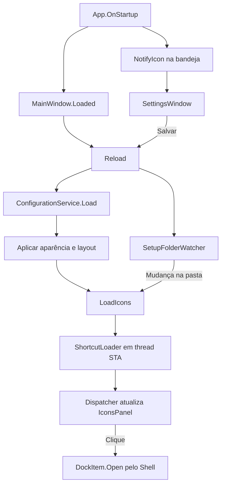

# DockApp — guia de desenvolvimento

O DockApp é um lançador de aplicativos para Windows escrito em C# e WPF. A dock pode reunir executáveis, pastas, documentos, atalhos e links registrados no Windows. Ela permanece acessível pela bandeja, mesmo quando a janela está oculta. A configuração pertence ao usuário do Windows e acompanha as execuções de Debug e Release.

Para começar pelo código, leia [App.xaml.cs](DockApp/App.xaml.cs) para entender o ciclo de vida, [MainWindow.xaml.cs](DockApp/MainWindow.xaml.cs) para seguir uma recarga e [DockSettings.cs](DockApp/DockSettings.cs) para conhecer o estado persistido. Este guia descreve o código do repositório em 26 de novembro de 2026.

## Capturas de tela

| Dock vertical | Menu de contexto |
|:---:|:---:|
|  |  |

### Janela de configurações

| Itens | Aparência |
|:---:|:---:|
|  |  |
| **Movimento** | **Comportamento** |
|  |  |

## Compilar e executar

Use Windows e o SDK .NET 10. O projeto gera um `WinExe` para `net10.0-windows`, com WPF e Windows Forms habilitados. Windows Forms fornece a bandeja e o seletor de cores. As dependências estão no framework e nas bibliotecas nativas do Windows. A solução contém um projeto e pode ser aberta no Visual Studio por [DockApp.slnx](DockApp.slnx).

Na raiz do repositório, execute em PowerShell:

```powershell
dotnet --list-sdks
dotnet build .\DockApp.slnx -c Release
.\DockApp\bin\Release\net10.0-windows\DockApp.exe
```

Para desenvolver com a configuração Debug:

```powershell
dotnet run --project .\DockApp\DockApp.csproj
```

A compilação Release foi conferida com o SDK 10.0.401. A saída padrão depende do .NET Desktop Runtime 10 no computador de destino. Mantenha o executável junto da DLL e dos arquivos auxiliares da saída. Antes de substituir a versão em uso, encerre o processo pelo menu **Sair** da bandeja. Ocultar a dock mantém o processo ativo.

**Primeira execução.** Com a lista vazia, clique em **Adicionar itens…**, selecione arquivos na aba **Itens** e salve. Para um teste rápido, adicione o Bloco de Notas ou uma pasta local. Clique no item da dock para abrir, oculte a dock pelo menu de contexto e use **Mostrar Dock** na bandeja para recuperá-la.

## Mapa do repositório

| Arquivo | Responsabilidade |
|---|---|
| [DockApp.csproj](DockApp/DockApp.csproj) | Define o alvo Windows, as tecnologias de interface, o manifesto, o ícone do executável e o recurso da bandeja. |
| [App.xaml](DockApp/App.xaml) e [App.xaml.cs](DockApp/App.xaml.cs) | Ponto de entrada WPF, criação da janela, menu da bandeja, log de exceções e encerramento explícito. |
| [MainWindow.xaml](DockApp/MainWindow.xaml) | Janela transparente sem moldura, botão da lista vazia e template dos ícones com transformações por item. |
| [MainWindow.xaml.cs](DockApp/MainWindow.xaml.cs) | Coordena carga, posição, aparência, monitoramento, interação, animações e balões. |
| [SettingsWindow.xaml](DockApp/SettingsWindow.xaml) | Interface de configuração em quatro abas, estilos WPF e rodapé com as ações de salvar e cancelar. |
| [SettingsWindow.xaml.cs](DockApp/SettingsWindow.xaml.cs) | Carrega campos, aplica perfis, valida cores, envia a prévia de fundo e confirma as preferências. |
| [SettingsWindow.Items.cs](DockApp/SettingsWindow.Items.cs) | Outra parte da mesma classe. Edita a coleção de itens, recebe arquivos arrastados, troca ícones e confirma a ordem. |
| [DockSettings.cs](DockApp/DockSettings.cs) | Modelo de configuração e enums dos efeitos. O arquivo fica na raiz do projeto e usa o namespace `DockApp.Models`. |
| [Models](DockApp/Models) | `PinnedItem` representa uma referência salva. `DockItem` contém o item pronto para exibição e abertura. `DockProfile` reúne os perfis. `DockPosition` identifica a borda da tela. |
| [Services](DockApp/Services) | Leitura e gravação das preferências, carga de ícones, monitoramento da pasta e integração com o login do Windows. |
| [app.manifest](DockApp/app.manifest) e [AssemblyInfo.cs](DockApp/AssemblyInfo.cs) | Declarações de DPI por monitor e localização dos recursos de tema WPF. |
| [Ícone do projeto](DockApp/ChatGPT-Image-26-de-set.-de-2026_-20_43_10.ico) | Fonte usada pelo build. Há uma segunda cópia de mesmo nome na raiz da solução. A referência do projeto aponta para a cópia dentro de `DockApp/`. |
| [LICENSE.txt](LICENSE.txt) | Licença MIT. O cabeçalho ainda contém os marcadores de ano e titular. |

A interface usa XAML, eventos em *code-behind* e bindings pontuais. Por exemplo, `IconSize` é uma propriedade de dependência da janela e cada ícone recebe um `DockItem` como contexto. Ao rastrear um comportamento, comece pelo evento no XAML, siga o manipulador na classe parcial e então o serviço chamado.

## Ciclo de vida e fluxo de dados



1. `App.OnStartup` registra o tratamento de exceções do Dispatcher, usa `OnExplicitShutdown`, cria e mostra a janela e configura o `NotifyIcon`.
2. `MainWindow.Reload` lê as preferências, cria uma instância de `ShortcutLoader`, aplica aparência e orientação, inicia a carga de itens e configura o observador da pasta. A posição final é recalculada após o layout.
3. Uma alteração na pasta pede uma nova carga de **itens**. Salvar as configurações provoca uma recarga **completa**, inclusive do cache e da pasta observada. Essa distinção evita reler as preferências e reconstruir a aparência a cada alteração de arquivo.
4. O duplo clique na bandeja mostra a dock. **Configurações** na bandeja também a torna visível antes de abrir o diálogo. Ao fechar a janela principal, a aplicação libera o observador. Ao sair, libera o ícone da bandeja e chama `Shutdown`.

## Origem, ordem e abertura dos itens

| Origem | Entrada | Ordem e personalização |
|---|---|---|
| Itens fixados | Arquivos, pastas ou links absolutos, inclusive protocolos como `steam://`. A grade aceita arquivos arrastados. | Aparecem primeiro, na ordem de `PinnedItems`. O usuário pode renomear, mover, desafixar e escolher uma imagem. |
| Pasta monitorada | Arquivos `.lnk` e `.url` diretamente na pasta escolhida. | Aparecem depois dos fixados, ordenados pelo caminho, com comparação cultural sem distinção de maiúsculas. Um caminho já fixado é omitido desta segunda lista. |

O diálogo de arquivos usa `DereferenceLinks = false`. Assim, escolher um atalho preserva seu caminho original. Desafixar remove a referência da coleção. Se o mesmo arquivo também estiver na pasta monitorada, ele poderá reaparecer como item dessa pasta.

**Contrato de abertura.** `DockItem.Open()` passa `SourcePath` ao `Process.Start` com `UseShellExecute = true`. Para um caminho local absoluto, preenche `WorkingDirectory` com o diretório pai, quando disponível. Ao receber o próprio `.lnk`, o Shell interpreta seus argumentos e a propriedade **Iniciar em**. Preservar esse fluxo é importante para jogos e programas que dependem de caminhos relativos. Documentos e protocolos usam o aplicativo associado no Windows. Se a chamada falhar, a dock exibe um balão no item clicado.

### Ícones, concorrência e cache

- `ShortcutLoader.LoadAsync` cria uma thread de segundo plano STA por varredura. Ela monta a lista e entrega o resultado por uma `Task`. Os controles WPF são atualizados no Dispatcher.
- A imagem personalizada tem prioridade. O carregador abre o arquivo com `BitmapCacheOption.OnLoad`, decodifica com largura de 192 pixels e chama `Freeze()`. Isso permite fechar o arquivo e usar a imagem congelada em outra thread. A interface oferece PNG, ICO, JPEG e BMP.
- Na ausência de imagem válida, um caminho de arquivo usa `SHGetFileInfo` para obter o índice do ícone na lista do Shell. `ImageList_GetIcon` recupera o ícone base sem a seta de atalho. O código converte o `HICON` em bitmap WPF e chama `DestroyIcon` em `finally`. Um link sem imagem própria pode usar o símbolo de fallback do template.
- O cache dura enquanto existir a instância de `ShortcutLoader`. A chave inclui o caminho do item, o da imagem personalizada e os dois horários de modificação em UTC. A varredura seguinte reaproveita imagens válidas e retém apenas as entradas pertinentes à lista atual.
- `FolderWatcherService` observa criação, exclusão, mudança e renomeação, sem incluir subdiretórios. Um `DispatcherTimer` de 300 ms agrupa eventos próximos. `_loadingIcons` e `_reloadPending` serializam as cargas da janela. Ao terminar, a janela compara a instância de configurações e o estado de fechamento antes de aceitar o resultado.
- A observação cobre a pasta configurada. Uma imagem personalizada alterada em outra pasta terá sua data conferida na próxima varredura. Se a pasta configurada estiver ausente durante `SetupFolderWatcher`, o monitoramento fica parado até uma nova configuração ou recarga.

## Interface, perfis e animações

**Itens** concentra a coleção editável e a pasta monitorada. **Aparência** reúne perfis, fundo, degradê, borda, sombra e dimensões. **Movimento** controla hover, abertura, cor do brilho e opacidade em repouso. **Comportamento** define borda da tela, distância, nomes ao passar o mouse, permanência no topo e início com o Windows. O rodapé permanece acessível ao mudar de aba.

A janela de configurações carrega sua própria instância de `DockSettings`. A grade edita cópias dos registros em uma `ObservableCollection<PinnedItem>`. **Aplicar perfil** preenche os campos do diálogo. **Salvar alterações** valida as cores, confirma a edição da grade, grava o JSON e atualiza a entrada de inicialização. **Cancelar** descarta a edição e a janela principal reaplica a aparência salva. A prévia enviada à dock durante a edição cobre a cor principal e a opacidade de fundo.

Os doze perfis são **Grafite, Aurora, Âmbar, Oceano, Floresta, Cerejeira, Neon, Cobre, Glacial, Vinho, Eclipse e Solar**. O catálogo contém cores, uso de degradê, hover, efeito de abertura opcional e opacidade em repouso. Ao aplicar um perfil, o diálogo também define ângulo de 30°, opacidade de fundo de 90% e espessura de borda de 1. O JSON guarda os valores resultantes. O usuário pode ajustar cada um depois.

**Geometria.** A dock usa `SizeToContent` e um `StackPanel` horizontal no topo ou na base, vertical nas laterais. Cada `ContentPresenter` recebe metade de `IconSpacing` como margem. `Window_SizeChanged` chama `PositionWindow` quando adicionar ou remover itens altera o comprimento. O cálculo usa `SystemParameters.WorkArea`. O manifesto declara `PerMonitorV2`, mas a aplicação não oferece seleção de monitor. As medidas de layout são unidades WPF independentes de dispositivo (DIP), mesmo quando a interface usa o rótulo “px”.

**Movimento.** As transformações do template têm funções distintas. A primeira escala cuida do hover, a translação produz o salto, a segunda escala produz o pulso e a rotação produz a inclinação. `EnsureAnimatableTransformGroup` clona o grupo se estiver congelado. O modo onda amplia o item ativo e até dois vizinhos de cada lado. O brilho usa um `DropShadowEffect` no ícone. A sombra da barra e a opacidade em repouso atuam no contêiner.

**Recorte e balões.** Uma `RenderTransform` altera o desenho depois da medição. `AnimationMargin()` reserva a área transparente necessária para combinar zoom, brilho, inclinação ou salto e desconta a folga já oferecida pelo layout. O salto se afasta da borda da tela. `PositionWindow` leva a margem em conta para manter a animação visível. O balão de nome espera 350 ms de hover. `CreateStyledPopup` escolhe o lado voltado para dentro da tela e ajusta a ponta após a abertura usando coordenadas reais do ícone. O balão de erro compartilha a mesma lógica de posicionamento.

## Configurações e integração com o Windows

| Recurso | Local | Uso |
|---|---|---|
| Preferências | `%APPDATA%\DockApp\settings.json` | JSON por usuário, lido e gravado por `ConfigurationService`. |
| Exceções da interface | `%APPDATA%\DockApp\crash.log` | O manipulador global acrescenta a exceção do Dispatcher e a marca como tratada. Alguns erros locais seguem apenas para `Debug.WriteLine`. |
| Login do Windows | `HKCU\Software\Microsoft\Windows\CurrentVersion\Run`, valor `DockApp` | `StartupService.SetEnabled` grava o caminho do executável entre aspas ou remove esse valor. Após mover a instalação, salve a preferência executando a nova cópia. |
| Identidade visual | `ApplicationIcon` e recurso lógico `DockApp.TrayIcon.ico` | O mesmo ICO alimenta o executável e o recurso incorporado que `LoadTrayIcon` lê para a bandeja. |

### Referência do JSON

| Propriedades | Padrão | Significado |
|---|---|---|
| `PinnedItems`, `FolderPath` | `[]`, `""` | Coleção ordenada e pasta opcional de atalhos. Cada fixado guarda `Path`, `Name` e `IconPath` opcional. |
| `Position`, `EdgeDistance`, `AlwaysOnTop`, `StartWithWindows` | Bottom, 5, false, false | Posicionamento e integração com o Windows. |
| `BackgroundColor`, `BackgroundColor2`, `UseGradient`, `GradientAngle`, `BackgroundOpacity` | #202020, #101010, false, 90, 0.70 | Cor ou degradê do fundo e sua opacidade. |
| `BorderColor`, `BorderThickness`, `CornerRadius` | #404040, 1, 18 | Contorno e cantos da barra. |
| `EnableShadow`, `ShadowOpacity`, `ShadowBlur`, `ShadowDepth` | true, 0.45, 18, 4 | Sombra da barra. |
| `DockPaddingHorizontal`, `DockPaddingVertical`, `IconSpacing`, `IconSize` | 12, 10, 8, 48 | Margens internas, distância entre itens e tamanho dos ícones. |
| `HoverStyle`, `HoverScale`, `AccentColor`, `ShowNames` | Zoom, 1.40, #69CFFF, true | Movimento do mouse, ampliação, cor do brilho e balão de nome. |
| `AnimateLaunch`, `LaunchStyle`, `IdleOpacity` | true, Bounce, 1 | Ativação e tipo da animação de abertura, opacidade da barra em repouso. |

Exemplo mínimo de uma configuração com dois itens. As propriedades omitidas recebem os inicializadores de `DockSettings`.

```json
{
  "PinnedItems": [
    { "Path": "C:\\Windows\\System32\\notepad.exe", "Name": "Notas", "IconPath": null },
    { "Path": "https://example.org/", "Name": "Portal", "IconPath": null }
  ],
  "Position": 3,
  "ShowNames": true,
  "EdgeDistance": 8
}
```

O valor `3` corresponde à borda direita. O serializador padrão grava os enums como números. As ordens atuais são `DockPosition` = Bottom, Top, Left, Right; `HoverEffect` = Zoom, Glow, ZoomAndGlow, None, Wave; `LaunchEffect` = Bounce, Pulse, Tilt. Cada sequência começa em zero. Preserve os números já gravados ao acrescentar opções. A escolha “Sem efeito” ao abrir usa `AnimateLaunch = false`.

Um arquivo ausente, ilegível ou com JSON inválido faz `Load()` devolver os padrões. A gravação usa `File.WriteAllText`, diretamente sobre o arquivo. A sequência “gravar JSON → atualizar Registro” pode, portanto, terminar com o JSON atualizado e a etapa do Registro pendente se houver uma falha. Para investigar preferências reais, faça uma cópia do arquivo antes de reproduzir o problema em Debug.

## Como continuar o desenvolvimento

| Alteração desejada | Implementação e verificação |
|---|---|
| Adicionar um perfil | Acrescente um registro em `DockProfile.All`. A lista da aba Aparência usa esse catálogo e mostra a amostra de cor e a descrição de movimento. Aplique, personalize um valor, salve e reabra a janela. |
| Criar uma preferência | Defina a propriedade e seu padrão em `DockSettings`. Ligue o controle a `LoadIntoFields` e `Save_Click` ou, para os campos geridos pela biblioteca, a `LoadItems` e `ApplyItems`. Aplique-a no consumidor e abra uma configuração antiga sem a nova chave. |
| Criar um efeito | Acrescente a opção ao enum e ao seletor em XAML. Implemente entrada, saída e retorno ao repouso em `MainWindow`. Atualize `DockProfile.MotionDescription` se o efeito for oferecido por um perfil. Inclua sua amplitude em `AnimationMargin` e teste junto com o zoom máximo. |
| Ampliar tipos da pasta monitorada | Ajuste o filtro de extensões em `ShortcutLoader.LoadItems`. A inclusão pela aba Itens já aceita arquivos gerais. Verifique abertura pelo Shell, ícone, ordem e coexistência do mesmo caminho nas duas origens. |
| Trocar a marca do aplicativo | Atualize o ICO indicado por `ApplicationIcon` no projeto. O recurso da bandeja referencia essa propriedade. Recompile e reinicie o processo para conferir o Explorer e a bandeja. |
| Trabalhar em posicionamento ou múltiplos monitores | Comece em `PositionWindow`, `AnimationMargin` e `CreateStyledPopup`. Valide área útil, escala de DPI, transformação de coordenadas e todos os lados da tela no mesmo cenário. |

## Validação e diagnóstico

A solução não contém projeto de testes automatizados versionado. A compilação verifica tipos, recursos e boa parte das ligações entre eventos e XAML. Para mudanças de comportamento, use o roteiro abaixo no Windows. Ele descreve verificações reproduzíveis, e não uma bateria executada a cada build.

| Cenário | Procedimento | Resultado esperado |
|---|---|---|
| Abertura de atalho | Fixar um `.lnk` com argumentos e **Iniciar em** diferente da pasta do executável. Abrir pelo Explorer e pela dock. | O programa recebe os mesmos argumentos e encontra os mesmos arquivos relativos. |
| Biblioteca e pasta | Fixar um atalho que também esteja na pasta observada. Criar, renomear e remover outro atalho na pasta. | O fixado aparece uma vez. As mudanças aparecem após o agrupamento dos eventos e a barra se recentraliza. |
| Persistência | Mudar ordem, nome, imagem e posição. Cancelar uma vez e salvar na segunda. Reiniciar. | Cancelar restaura o estado anterior. Salvar mantém as escolhas após o reinício. |
| Efeitos e recorte | Usar zoom máximo e pouca margem interna. Testar salto, pulso e inclinação no primeiro e no último ícone em cada borda. | O ícone permanece inteiro, inclusive no ponto máximo da animação. |
| Balões e DPI | Passar o mouse entre itens vizinhos e testar um nome longo perto do canto da tela. Repetir com outra escala do Windows. | A ponta acompanha o item correto e o balão fica legível. |
| Bandeja e login | Ocultar, mostrar, abrir configurações e sair pela bandeja. Em uma conta de teste, alternar o início automático. | Ocultar preserva o processo. Sair encerra a aplicação. O valor no Registro acompanha a opção salva. |

**Se um item não abrir**, confira primeiro o `SourcePath` original e abra o mesmo arquivo ou protocolo pelo Explorer. Se o caminho depender de uma unidade de rede ou se o protocolo depender de um launcher, reproduza com esse recurso disponível. O balão de erro de lançamento é genérico. Para descobrir a exceção exata, depure `DockItem.Open` e `Icon_Click`.

**Se uma preferência parecer perdida**, confirme qual cópia do executável está rodando, o usuário da sessão e o conteúdo do JSON. O carregamento usa os padrões em caso de falha de leitura. O log global registra as exceções que chegam ao Dispatcher; falhas já tratadas pelo carregador podem aparecer somente na saída de depuração.

**Se o build indicar WFO0003**, confira o manifesto e o uso simultâneo de WPF e Windows Forms. O aviso já foi observado em recompilações por causa das declarações de DPI. Uma mudança nessa configuração deve ser validada visualmente em diferentes escalas, especialmente na posição da dock e nos balões.
